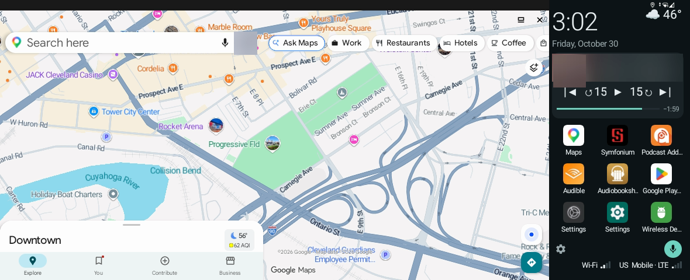
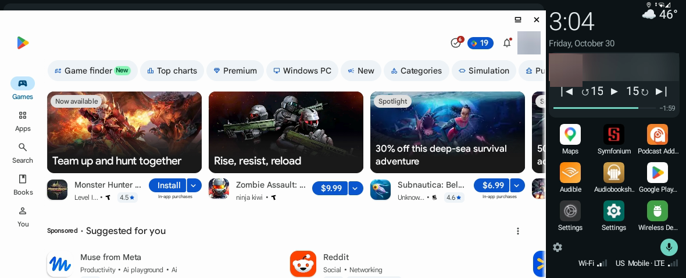
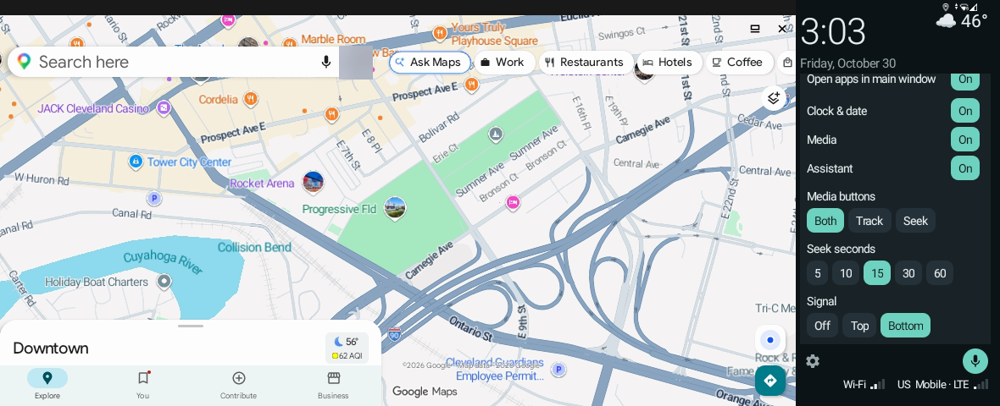
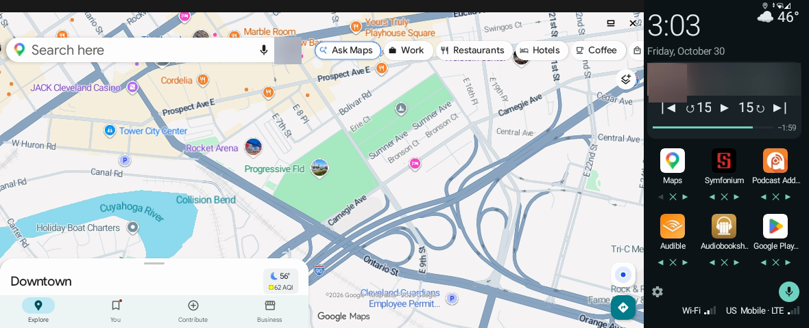
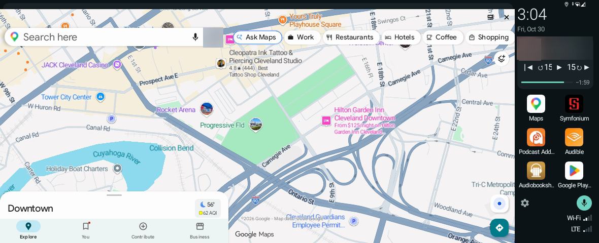
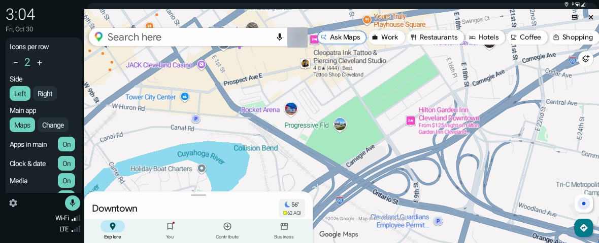
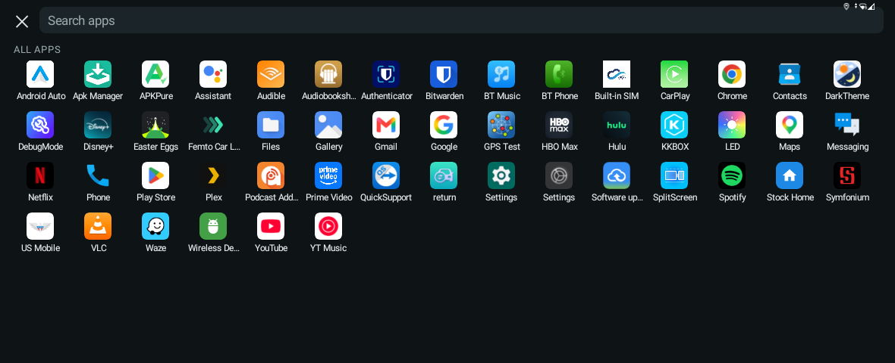

# MiniCarHome

An easy-to-use, clutter-free home launcher for cars with Android "AI boxes", such as the
[**MMB MAX CarPlay AI Box for BMW 2023+ (iDrive 8/8.5/9), Android 13, 8+128GB**](https://www.amazon.com/dp/B0GXK6XD3N).
That's the box this was built and tested on, and it works with the **2023 MINI Cooper SE**.

Your navigation app runs live in a big window, and a slim panel beside it holds the clock, weather,
what's playing and the apps you actually use in the car. No ads, promo tiles or floating buttons.

It's currently configured for the **2023 MINI Cooper**'s 8.8-inch touchscreen, which the box drives
at **1180 × 480 pixels (120 dpi)**. Most of the layout adapts to the screen, but sizes and spacing were
tuned there. (The unit it was built on reports Android 14.)


<sub>Home screen: Google Maps in the main window, the panel on the right with weather, now playing,
shortcuts and signal. (Account photo and track details blurred.)</sub>

## Features

### A big main window for navigation (or any app)
Google Maps runs live in the main window, sized to fill everything the panel doesn't use, and it opens
by itself at startup. In settings you can pick any other app as the **main display app** (Waze, a music
app, anything).

### Apps open in the main window
Tap an app in the panel or the app list and it opens **in the main window**, where Maps was, with the
panel still beside it. Open another app and it replaces the previous one. **Home** brings Maps back, and
Maps keeps running underneath the whole time, so you don't lose your route. (Turn this off in settings
to open apps full screen instead.)


<sub>The Play Store opened from the panel, running in the main window.</sub>

Android's own Settings app is the one exception: Android hides every app's overlay windows while it's
in front, so the panel disappears until you leave Settings.

### The panel
- **Clock and date**, with **weather** beside it (current conditions, high and low) when the panel is
  3 or more icons wide.
- **Now playing**: artwork, title, a progress bar and time remaining, and controls for whatever is
  playing (Podcast Addict, Audible, Spotify, Symfonium…): previous/next track (|◀ ▶|), seek back and
  forward (↺15 15↻) and play/pause. Tap the card to open that app.
- **Shortcuts** to your car apps, scrolling if they don't fit, plus **All apps**.
- **Assistant button**: starts Google's voice assistant ("navigate to…", "call…").
- **Wi-Fi and cell signal** with bars, plus the carrier and network type.

### Settings (gear, bottom left)
| Setting | Options |
|---|---|
| Icons per row | 2–5; sets the panel's width (default 3). The main window grows into any space freed up |
| Side | Panel on the left or right |
| Main display app | Any app; Google Maps by default |
| Open apps in main window | On / off |
| Clock & date, Media, Assistant | Each on / off |
| Media buttons | Both (track + seek, default), Track only or Seek only |
| Seek seconds | 5, 10, 15 (default), 30 or 60 |
| Signal | Off, top or bottom |
| Edit shortcuts | Move (◀ ▶), remove (✕) and add (+, from the full app list) |
| Reset shortcuts | Back to the default list |

Everything is saved and kept across reboots.

<p>


</p>
<sub>Left: settings. Right: editing shortcuts.</sub>

### Narrow or wide, left or right
The panel compacts itself as it narrows: shorter date, a smaller music card, stacked signal indicators.

<p>


</p>
<sub>Left: 2 icons per row. Right: panel on the left side, with settings open.</sub>

### App browser
**All apps** opens a full-screen browser with search, a row of recently used apps and every app A–Z.



### Box Tools (companion app)
- **Edge gestures** replace the box's floating ball: swipe in from the left or right edge for **Back**,
  swipe up from the bottom for **Home**, swipe up and pause for **Recent apps**.
- **Wireless Debug** icon: turns ADB-over-Wi-Fi back on after a reboot in one tap.
- **Stock Home** icon: opens the box's original launcher.
- Closes and reopens the main window's app when you change the panel width or side. Android doesn't let
  one app resize another app's open window.

## Install

Both apps are in this repo, prebuilt (`minicarhome/apk/`, `boxtools/apk/`) and as source. Install
**Box Tools first**, because it defines the permission MiniCarHome uses, then run the one-time setup over ADB:

```sh
adb install boxtools/apk/boxtools.apk
adb install minicarhome/apk/minicarhome.apk

# MiniCarHome
adb shell settings put global enable_freeform_support 1
adb shell settings put global hidden_api_blacklist_exemptions "Landroid/app/ActivityOptions;->setLaunchWindowingMode"
adb shell appops set com.kynrek.minicarhome SYSTEM_ALERT_WINDOW allow
adb shell cmd notification allow_listener com.kynrek.minicarhome/com.kynrek.minicarhome.MediaListener 0
adb shell pm grant com.kynrek.minicarhome android.permission.READ_PHONE_STATE
adb shell pm grant com.kynrek.minicarhome android.permission.ACCESS_COARSE_LOCATION
adb shell settings put secure icon_blacklist clock          # optional: hide the status-bar clock
adb shell cmd package set-home-activity com.kynrek.minicarhome/.HomeActivity

# Box Tools
adb shell pm grant local.boxtools android.permission.WRITE_SECURE_SETTINGS
adb shell settings put secure enabled_accessibility_services local.boxtools/local.boxtools.NavGestureService
adb shell settings put secure accessibility_enabled 1
adb shell pm disable-user --user 0 com.applepie.floatingball   # optional: hide the vendor floating ball
```

Back to the stock home screen:
`adb shell cmd package set-home-activity com.android.launcher3/.uioverrides.QuickstepLauncher`

## Troubleshooting

**Tip for the MMB BMW box (from its support instructions):** after connecting the box to a power
source, use your phone to search for the Bluetooth device named **"JoyeBox"**, then dial
**#135177**. The LED indicator light switches from steady white to steady red.

**The box keeps rebooting and ADB drops.** If the box can reach your car over Bluetooth and Wi-Fi, it
starts a wireless CarPlay session; when that link drops, the box's CarPlay service reboots Android,
which also turns Wireless debugging off. Tap **Wireless Debug** (Box Tools) to turn it back on.

**An app opens full screen instead of in the main window.** Android won't move a window that's already
open. Swipe the app away in Recents once and it will open in the main window from then on.

## Build

No Gradle needed: just the Android SDK build tools and platform 36 in `~/Library/Android/sdk`, and a JDK 21.

```sh
JAVA_HOME=/path/to/jdk-21 zsh minicarhome/build.sh
JAVA_HOME=/path/to/jdk-21 zsh boxtools/build.sh
```

Each writes `out/<name>.apk`, signed with `~/.android/debug.keystore`. Both apps must be signed with
the same key.

## How it works

- The main window is a **freeform window**. MiniCarHome opens apps there with explicit launch bounds,
  which needs the developer setting `enable_freeform_support` and a hidden-API exemption for
  `ActivityOptions.setLaunchWindowingMode`.
- The panel and app browser are **overlay windows**. Since Android 14, Google Maps carries a full-screen
  input sink (touch-opaque activities) that swallows touches meant for the home screen underneath it.
- Android won't resize another app's open window, so on a width or side change MiniCarHome asks Box
  Tools' accessibility service to tap the old window's ✕, then reopens the app at the new size.
- Weather comes from [Open-Meteo](https://open-meteo.com/) (free, no key) for the box's location,
  rounded to about 1 km.
- Launcher icons that only bounce to another screen (Podcast Addict) are mapped to their real screen
  in `TRAMPOLINES`, because the bounce doesn't land inside a freeform window.

## License

[MIT](LICENSE). Icons are from Google's Material icons (Apache 2.0).
